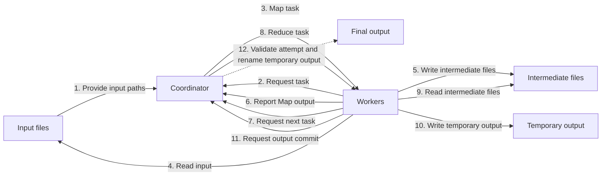
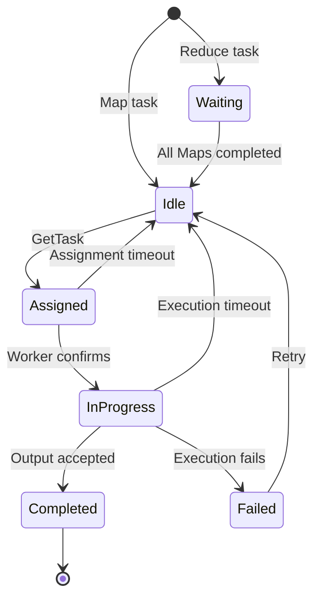

# MapReduce

Implemented a high-performance MapReduce framework focused on concurrent execution, fault tolerance, and efficient data processing.

## Architecture

Numbering follows a successful Map-to-Reduce path; tasks within each phase may run concurrently.

The Coordinator and Workers share a local filesystem. Workers read input and intermediate files by path, and the Coordinator renames Reduce outputs there.

## Task scheduling

Each input file becomes a Map task; each output partition becomes a Reduce task. Reduce tasks wait until all Map tasks complete. Workers request tasks from the Coordinator, which assigns runnable tasks and tracks their state. Failed or timed-out tasks are requeued up to a retry limit; the `AttemptID` prevents stale attempts from submitting output.

## Data processing

1. **Map:** Read input files, call `mapf`, sort records by key, and partition them using `ihash(key) % NReduce`.
2. **Partition output:** Write partitions concurrently through buffered writers to reduce small writes. Report their file paths to the Coordinator for Reduce tasks.
3. **Reduce:** Read intermediate files concurrently. Since each partition file is sorted, use a min-heap to merge them without sorting all records again. Group equal keys and call `reducef` sequentially.
4. **Output:** Write Reduce results through a buffer to a temporary file. The Coordinator validates the attempt and renames the file to its final path.

| File | Name |
| --- | --- |
| Map intermediate | `mr-TaskID-AttemptID-PartitionID` |
| Reduce attempt output | `mr-reduce-TaskID-AttemptID-PartitionID` |
| Final output | `mr-out-PartitionID` |

The current entry point creates one job per Coordinator. Coordinator state is held in memory, and each Reduce task loads its intermediate records into memory before merging.
